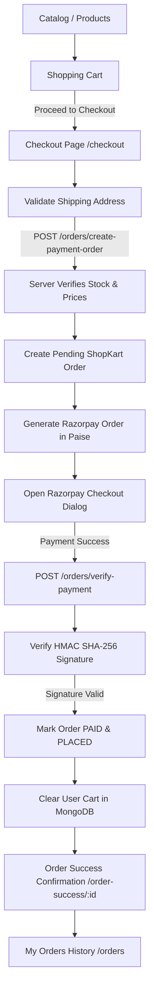

# 🛒 ShopKart — Full-Stack E-Commerce Platform (MERN)

> **ShopKart** is a comprehensive, production-ready full-stack e-commerce web application built using the MERN stack (MongoDB, Express, React, Node.js). It supports end-to-end user journeys including customer authentication, product discovery, wishlist management, cart state management, checkout with Razorpay payment integration, and persistent order history.

---

## 🌟 Features Overview

- **🔐 Customer Authentication & Security:** JWT-based authentication using HTTP-only cookies and Authorization headers, encrypted passwords with `bcrypt`, protected user-specific routes.
- **🛍️ Product Discovery & Filtering:** Real-time search, category filtering, price/alphabetical sorting, product details view with live stock availability indicators.
- **💖 Wishlist Management:** Interactive toggle for saving favorite items, persistent per-user wishlist, dynamic navbar count badges.
- **🛒 Dynamic Shopping Cart:** Quantity increments/decrements, server-side stock validation, derived totals, responsive cart drawer.
- **💳 Checkout & Razorpay Test Payment:** Shipping address validation (with 6-digit pincode check & phone verification), Razorpay Standard Checkout SDK integration, server-side total calculation in paise (`amount * 100`).
- **🛡️ Payment Verification & Security:** Mandatory HMAC SHA-256 signature verification on backend using database-stored `razorpayOrderId` and secret. Cart is only cleared upon verified payment.
- **📦 Historical Order Snapshotting:** Order items snapshot product name, image, and price at time of purchase so future price edits never alter past orders.
- **📜 My Orders & Order Details:** View past purchases, order status badge, and bonus live order progression stepper (`PLACED` → `CONFIRMED` → `SHIPPED` → `DELIVERED`).

---

## 🏗️ System Architecture & Purchase Journey



---

## 🗂️ Project Structure

```text
shop-kart/
├── backend/
│   ├── config/
│   │   └── razorpay.js            # Razorpay SDK configuration
│   ├── controllers/
│   │   ├── auth.controller.js     # Auth logic
│   │   ├── cart.controller.js     # Cart operations & stock validation
│   │   ├── customer.controller.js # Profile management
│   │   ├── order.controller.js    # Checkout, Razorpay order & signature verification
│   │   ├── product.controller.js  # Product querying & search
│   │   └── wishlist.controller.js # Wishlist toggle & count
│   ├── middlewares/
│   │   └── auth.middleware.js     # JWT token verification
│   ├── models/
│   │   ├── customer.model.js      # Customer & cart schema
│   │   ├── order.model.js         # Order snapshot & payment status schema
│   │   └── product.model.js       # Product schema
│   ├── routes/
│   │   ├── cart.routes.js
│   │   ├── customer.routes.js
│   │   ├── order.routes.js
│   │   ├── product.routes.js
│   │   └── wishlist.routes.js
│   ├── utils/
│   │   └── generateToken.js
│   ├── index.js                   # Express application entrypoint
│   ├── package.json
│   └── .env.example               # Template environment variables
│
├── frontend/
│   ├── public/
│   ├── src/
│   │   ├── components/
│   │   │   ├── CartItem.jsx
│   │   │   ├── CheckoutForm.jsx   # Shipping address inputs with validation
│   │   │   ├── Navbar.jsx         # Dynamic badges for Cart and Wishlist
│   │   │   ├── OrderCard.jsx      # Order card with status progression
│   │   │   ├── OrderSummary.jsx   # Summary breakdown & Pay with Razorpay button
│   │   │   ├── ProductCard.jsx
│   │   │   └── WishlistCard.jsx
│   │   ├── context/
│   │   │   └── CartContext.jsx    # Global cart state & derived calculations
│   │   ├── pages/
│   │   │   ├── Cart.jsx
│   │   │   ├── Checkout.jsx       # Checkout flow & Razorpay modal handler
│   │   │   ├── Home.jsx
│   │   │   ├── Login.jsx
│   │   │   ├── OrderDetails.jsx   # Detailed order view
│   │   │   ├── Orders.jsx         # My Orders history page
│   │   │   ├── OrderSuccess.jsx   # Post-purchase confirmation
│   │   │   ├── ProductDetails.jsx
│   │   │   ├── Products.jsx
│   │   │   ├── Register.jsx
│   │   │   └── Wishlist.jsx
│   │   ├── services/
│   │   │   └── api.js             # Centralized Axios API client
│   │   ├── App.jsx                # Application routes
│   │   └── main.jsx
│   ├── index.html
│   ├── package.json
│   └── vite.config.js
│
├── .gitignore                     # Protects secrets & node_modules
└── README.md
```

---

## ⚙️ Setup & Installation Instructions

### Prerequisites
- [Node.js](https://nodejs.org/) (v16 or higher)
- [MongoDB](https://www.mongodb.com/) (running locally or MongoDB Atlas connection string)
- [Razorpay Test Account](https://dashboard.razorpay.com/) (free test mode keys)

---

### 1. Clone the Repository
```bash
git clone https://github.com/lakkireddymanasvi2007-tech/shop-kart.git
cd shop-kart
```

---

### 2. Backend Setup
1. Navigate to the `backend` folder:
   ```bash
   cd backend
   ```
2. Install dependencies:
   ```bash
   npm install
   ```
3. Create a `.env` file from the example:
   ```bash
   cp .env.example .env
   ```
4. Configure your `.env` variables:
   ```env
   MONGODB_URI=mongodb://127.0.0.1:27017/shopkart
   JWT_SECRET=your_jwt_secret_key_here
   JWT_EXPIRE=7d
   PORT=5000
   COOKIE_EXPIRE=7

   # Razorpay Test Mode Credentials
   RAZORPAY_KEY_ID=rzp_test_xxxxxxxxxxxxxx
   RAZORPAY_KEY_SECRET=your_razorpay_secret_here
   ```
5. Seed initial products (optional):
   ```bash
   node seedProducts.js
   ```
6. Start the backend server:
   ```bash
   node index.js
   # or with nodemon:
   npm run dev
   ```
   *The backend will run on `http://localhost:5000`.*

---

### 3. Frontend Setup
1. Open a new terminal tab and navigate to the `frontend` folder:
   ```bash
   cd frontend
   ```
2. Install dependencies:
   ```bash
   npm install
   ```
3. Start the Vite development server:
   ```bash
   npm run dev
   ```
   *The frontend will run on `http://localhost:5173`.*

---

## 📡 API Endpoints Reference

### Authentication
- `POST /customers/register` — Register a new customer
- `POST /customers/login` — Customer login & JWT issuance
- `GET  /customers/me` — Get current logged-in customer profile
- `POST /customers/logout` — Clear auth cookie

### Products
- `GET  /products` — Get all products (supports `search`, `category`, `sort`)
- `GET  /products/:id` — Get single product details

### Wishlist
- `GET    /wishlist` — Get user wishlist
- `POST   /wishlist/:productId` — Add to wishlist
- `DELETE /wishlist/:productId` — Remove from wishlist
- `PATCH  /wishlist/:productId/toggle` — Toggle product in wishlist
- `GET    /wishlist/count` — Get total items count

### Cart
- `GET    /cart` — Get user cart with populated product data
- `POST   /cart/:productId` — Add item to cart
- `PATCH  /cart/:productId` — Update item quantity (validates stock)
- `DELETE /cart/:productId` — Remove item from cart
- `DELETE /cart` — Clear entire cart

### Orders & Payments
- `POST   /orders/create-payment-order` — Re-validates stock & prices, generates ShopKart order & Razorpay order
- `POST   /orders/verify-payment` — Verifies HMAC SHA-256 signature, updates order to PAID, decrements stock, clears cart
- `GET    /orders` — Get current customer's order history
- `GET    /orders/:id` — Get single order details (ownership protected)
- `PATCH  /orders/:id/status` — (Bonus) Update order status progression

---

## 🛡️ Security & Engineering Best Practices

1. **Zero Secret Leakage:** `.env` and sensitive API keys are strictly excluded via `.gitignore`.
2. **Server-Side Price Authority:** The backend never trusts client-sent totals or prices. All calculations are executed directly using latest database values.
3. **Inventory Race Prevention:** Product stock is verified once during order initiation and decremented upon verified payment.
4. **Data Immutability:** Product attributes are snapshotted in each Order document at purchase time.
5. **HMAC SHA-256 Signature Verification:** Razorpay payment verification uses Node's native `crypto` module with database-stored order IDs rather than browser-provided order IDs.

---

## 👨‍💻 Author

**Manasvi Lakkireddy**  
GitHub: [@lakkireddymanasvi2007-tech](https://github.com/lakkireddymanasvi2007-tech)
